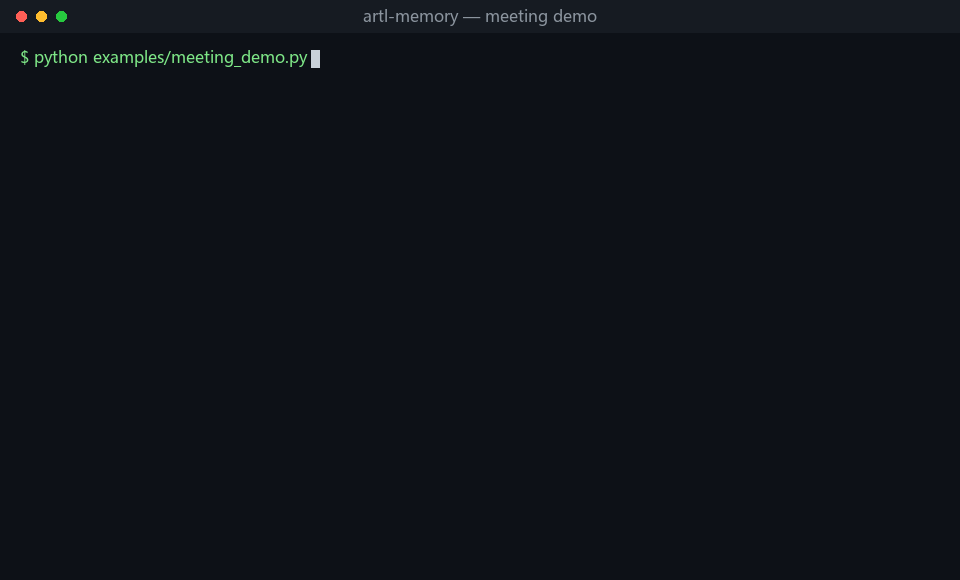

# artl-memory

**The multi-person memory layer for agents.**
逐句原话 · 按人隔离 · 证据链 · 把握度。

> It remembers everyone in the room — separately.
> 我们不承诺理解，我们承诺不忘。

[English](README.md)

artl-memory 从生产环境的自研助理中抽出。它不做"总结你的画像然后假装懂你"
——它保存**谁、在什么时间、
说了什么原话**，每条记忆带着来源和把握度；记错了就标记失效，证据链留在原地。

> **边界：它是账本，不是耳朵。** 库里没有音频、没有 ASR、没有声纹——
> "这句话是谁说的"由上层管线（声纹 / 说话人分离 / 人工标注）判断完，
> 把人名交给它记账。零依赖就是这么来的：不接声纹也能用，接了即插即用。

```bash
pip install artl-memory
```



*上面每一帧都是 [`examples/meeting_demo.py`](examples/meeting_demo.py) 的真实运行——含断言。25 秒，零摆拍。*

## 该选哪个记忆层？

来看记忆库的人，参照物几乎都是 Mem0（6 万多星），绕不开，那就直接摆开说。
这四个工具回答的是**不同的问题**——这张表帮你选型，不是打榜。

| | **artl-memory** | **Mem0** | **memoripy v4** | **MCP memory（官方）** |
|---|---|---|---|---|
| 写入要不要调 LLM | **不用**，零模型调用 | 要，每次 `add()` 过抽取模型 | 非必需，确定性抽取器，可自接模型 | 不用，agent 自己决定记什么 |
| 存的是 | **逐句原话** + 派生事实 | LLM 抽取的摘要 | 证据 + 派生记忆，带版本 | 实体/关系/观察三元组 |
| 记忆能追到来源吗 | 能，每条带 `source_event` + 把握度 | 部分，抽取会改写措辞 | 能，citations + receipts | 不能 |
| 多人隔离 | **一等公民**：按人分账，技能拿受限 `MemView` | 按 `user_id` 分区 | 按 `user_id` 分区 | 没有，全库共享一张图 |
| 删除 | **物理硬删**：secure_delete + VACUUM + WAL 截断，字节级扫描验证 | API 删除，向量库语义 | forget 工具 | JSONL 上的删除工具 |
| 完全离线可用 | 是 | 否（LLM + 向量库调用） | 是 | 是 |
| 语义（向量）检索 | **可选插口**：默认 bigram（可解释），`[semantic]` 额外包接嵌入 | 有 | 可选嵌入 | 没有，子串匹配 |
| 依赖 | **0**（标准库 `sqlite3`） | LLM 客户端 + 向量库 + embedding | 0 必需（v4） | Node.js 运行时 |

公道话：

- **选 Mem0**：要"说完话自动长出画像"、要语义检索、要成熟的框架集成
  （LangChain/CrewAI/AutoGen）和公开 benchmark 数字——这些都是真价值。
  代价它自己社区也记着账：一次 10134 条条目的审计发现 97.8% 是垃圾，
  包括幻觉出来的用户画像会被反复再抽取、跨会话放大
  （[mem0#4573](https://github.com/mem0ai/mem0/issues/4573)）；HaluMem
  基准发现抽取阶段的幻觉在 LLM 系记忆系统里是系统性的
  （[arXiv:2511.03506](https://arxiv.org/abs/2511.03506)）。如果记忆措辞
  不需要"可证明就是某人原话"，这个代价对你可能完全划算。
- **选 memoripy**：认同证据优先理念、但场景是**单用户**，且想要开箱即用的
  官方 MCP server。
- **选官方 MCP memory**：一台机器一个 agent 的极简记事本。它自称参考实现，
  也确实就是参考实现。
- **选 artl-memory**：当问题是"**多个人对一个 agent 说话——会议室、家庭、
  调解现场——而且记录日后要站得住**"：谁说了哪句原话、转写把握度多少、
  改口之前系统信的是什么、王强要求删除时能不能真删到字节级。
  需要聪明画像就别选我们——这个 README 下面还会再劝退你一次。

## 为什么是 multi-person

市面上的 agent 记忆方案（Mem0、Letta、Zep……）能按 user_id 分区，
但做不到**同一段对话里多人的原话分开记账**——它们的模型是一人一份画像。
artl-memory 从第一天就是多人模型：

- **人数无硬上限**：按人分账意味着 100 个人和 1 个人的单次召回成本
  相同——每人只扫自己的账。实测 100 人 × 200 条（共 2 万条），单次召回
  中位 0.4ms、零隔离违规（Windows，Python 3.14）

- **按人隔离**：王强的旧话不会进李四的口；技能/插件只见自己的记忆——
  `MemView` 上不挂 store 本体，正常 API 面没有别人的入口
  （同进程 introspection 挖得回去，要防恶意代码请上进程边界）
- **逐句原话**：先存原文，判断当场重算；改写原文在这条链路里不存在
- **证据链**：每条记忆带 `source_event`（它是从哪句话来的）和 `confidence`；
  改口了，旧值标记失效并挂在 `supersedes` 上——**失效不是删除**
- **到期降级**：原话留 N 天，没被引用的整行清，被引用的清正文留摘要
- **被遗忘权**：`store.purge_designer("王强")` 把这个人的五类数据真删干净，
  返回各类删了多少条——是硬删除，不是标记

## 上手（30 秒）

```python
from artl_memory import SqliteMemoryStore, MemoryService, MemView

store = SqliteMemoryStore("memory.db")
mem = MemoryService(store, designer="heima")

mem.remember("preference", "王强:预算", "三十万",
             source="utterance:wq-001", confidence=0.9)
mem.recall("王强的预算")        # 相关度 × 把握度 × 时间衰减，每个因子可解释

view = MemView(store, owner="skill:render", designer="heima")
view.put("风格", "奶油风")       # 技能的记忆，别人的进不来
```

跑通多人示例：

```bash
python examples/two_people.py
```

## 零依赖，两个后端

- **零硬依赖**：只用标准库（`sqlite3` 内置）。记忆层不该拖着一堆包进门。
- `InMemoryStore`：测试与试用（非线程安全）；`SqliteMemoryStore`：WAL、
  单连接、连接被关自动重开、坏文件自动隔离、schema 带版本号。
- 同一套一致性测试跑两个后端：`python tests/test_conformance.py`（也兼容 pytest）
- 对抗性测试管"没说也不许炸"：`python tests/test_adversarial.py`

## 可选语义召回（0.3+）

核心继续零依赖；"懂不懂换说法"做成可选插口，和"耳朵自带"是同一个哲学——
聪明自带，账本不动：

```python
from artl_memory.contrib import EmbeddingScorer, fastembed_scorer

mem = MemoryService(store, designer="王强",
                    recall_scorer=fastembed_scorer())   # 本地 bge-small-zh
# 或者接任何 embedding API：
mem2 = MemoryService(store, designer="王强",
                     recall_scorer=EmbeddingScorer(你的批量embed函数))
```

- **红线：scorer 只负责找，不负责写**。它只能给库内已有候选改排序分，
  注入不了新记忆；原话、证据链、把握度始终由核心保管
- 合并公开：`相关度 = 字词分 + semantic_weight × 语义分`（默认 3.0）；
  字词零重叠的条目需语义分 ≥ `semantic_min`（默认 0.5）才进结果
- 每条结果带 `recall_detail`：`word / semantic / confidence / decay`
  四因子分列——"为什么想起这条"装了语义也照样可查
- scorer 挂了（API 宕了）：警告 + 退化纯字词打分，召回不跟着死
- `pip install artl-memory[semantic]`；不装就是纯零依赖，行为一字不变

## MCP server：接进 Claude / Cursor（0.5+）

上面的一切也有 [MCP](https://modelcontextprotocol.io) 服务器形态——
Claude Desktop / Cursor 配置里加一段，你的助手就有了真的多人记忆：

```json
{
  "mcpServers": {
    "artl-memory": {
      "command": "uvx",
      "args": ["--from", "artl-memory[mcp]", "artl-memory-mcp",
               "--db", "/abs/path/memory.db"]
    }
  }
}
```

八个工具：`remember`、`recall`、`recall_all`（问全屋，每条标明是谁的）、
`list_people`、`evidence_chain`、`forget`、`purge_person`（物理删除，
字节级可验）、`export_person`。核心依旧零依赖——`mcp` 包只随 extra 进来。
协议层用真 stdio 握手测试钉死（起子进程、初始化、调用），不是 mock。

## 证据链溯源与 GDPR（0.4+）

```python
chain = mem.evidence_chain(item_id)      # [现在, ..., 最早]，每环带来源和失效时间
data  = mem.export_designer("王强.json") # 五表全量打包成 UTF-8 JSON（查数据）
store.purge_designer("王强")             # 物理硬删，字节级验证（删数据）
```

查数据 + 删数据两项权利成对闭环；回归测试钉死"purge 后导出必须全空"。

召回质量的**公开评测**在 [benchmarks/](benchmarks/)：3 人物、12 写入、
10 查询全部写死在脚本里，字符串包含判定（裁判不是选手），字面命中 /
改口时效 / 按人隔离 / 换说法单列，Mem0 对照一键可跑。

## 边界（写在明处）

- 值经 JSON 序列化存储：`tuple` 读出会变 `list`，自定义对象请自己序列化。
- `recall` 是 O(n) 全量打分——为可解释性刻意不做索引。扫描上限由
  `MemoryService(recall_window=...)` 控制，默认 10000 条；窗口打满时
  发 `RuntimeWarning`，最老的条目可能没参与打分，不会静默截断。
  窗口只截无 key 的流水：每个非空 key 的最新有效条目保底参与打分，
  "这个槽现在的值"不会被流水挤掉（0.3+）。
  批量导入请用 `remember_many(...)`（整批一次落盘，比逐条快约两个数量级），
  并确认窗口大于你的条目总量。
- **recall 默认只按字词重叠打分，不懂释义**。换说法、中英混写会找不到：
  查询 `who pays thirty万 for the living room` 召不回中文条目「三十万」。
  需要语义，用可选插口（0.3+）：`pip install artl-memory[semantic]` 或
  `EmbeddingScorer(你的 embedding 函数)`——引擎自带，核心不内置。
- 时间衰减有 0.4 的下限：很旧的高把握度条目会一直参与排序，只是权重打折。
  想让旧记忆彻底退出排序，请 `forget` 它（失效，不删除）。
- 空查询返回空列表——"你想找什么"没有答案时，不假装理解。
- 锁的边界：`MemoryService.remember` 的线程安全由服务层锁保证；
  `InMemoryStore` 本身不是线程安全的，请只经服务层使用。
  多进程写同一个 SQLite 文件由数据库层的唯一索引兜底
  （同槽位同 key 全库只允许一条有效），冲突方自动重读收敛。

## 明确不做

- **核心不内置向量检索**。默认 bigram 召回是刻意的：你随时能看清
  "它为什么想起这条"。需要语义走可选插口（0.3+），引擎自带、核心不沾。
- **不做云端同步、不做多机**。数据在你的文件里，这是特性不是缺陷。
- **不调用任何大模型**。记忆层不知道 LLM 存在——脑子随便换，记忆不动。

## English

See [README.md](README.md).

## License

Apache-2.0 · ARTL family
